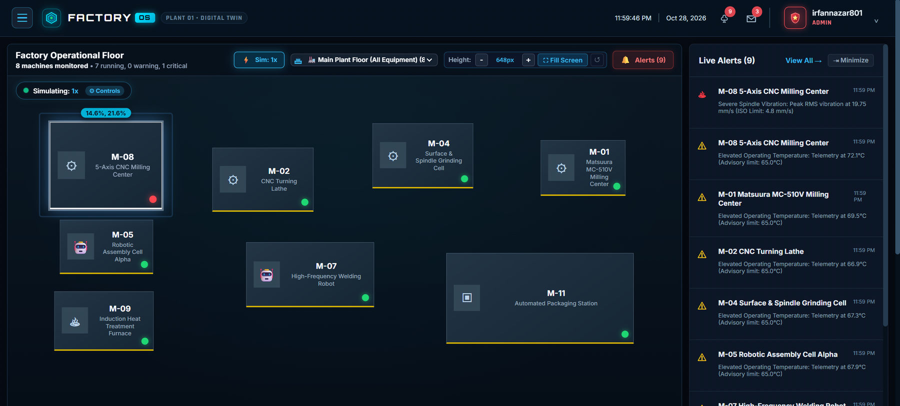
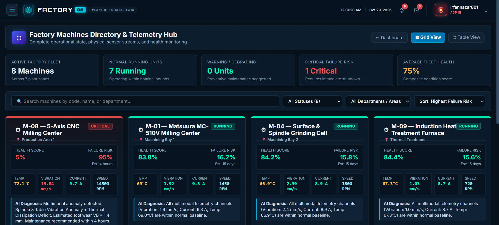
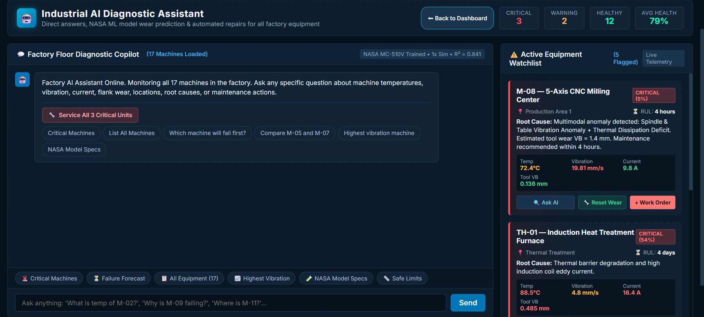
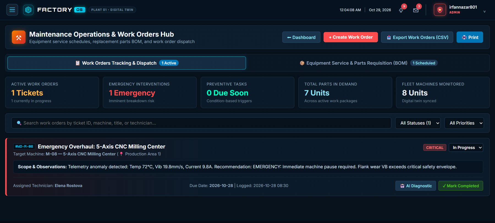
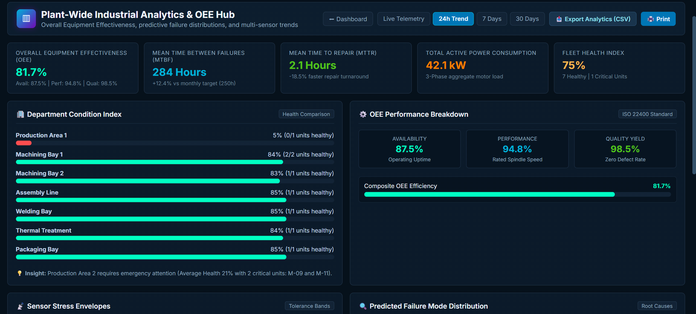

# FactoryOS

**An AI-powered, interactive digital twin for smart factory monitoring and predictive maintenance.**

FactoryOS gives a factory team a live virtual replica of its machines. It simulates sensor data, scores each machine's health, predicts tool wear and failure risk, raises alerts, and turns problems into maintenance work orders, all from one web dashboard.

## Screenshots

**Factory floor dashboard:** live machine status, simulation controls and real-time alerts.



**Machines and telemetry:** health score, failure risk, estimated time to failure and live sensor readings for every machine.



**AI diagnostic assistant:** ask about any machine, see flagged equipment with root causes and remaining useful life, and trigger actions like a work order.



**Maintenance and work orders:** track tickets, priorities and assigned technicians.



**Analytics:** OEE, MTBF, MTTR, department condition index and fleet health.



## Features

- **Live factory dashboard:** machines laid out on a floor plan with real-time status (running, warning, critical), plus saved layout presets
- **Digital twin simulation:** a sensor simulator models tool wear, vibration, temperature, motor current and acoustic emission, with time acceleration (up to 360x), pause, and fault injection (coolant loss, tool chipping, spindle overload)
- **Health and failure prediction:** per-machine health score, failure probability, predicted flank wear, remaining useful life and recommended actions
- **Anomaly scoring:** separate anomaly scores for vibration, acoustic emission, temperature and current load
- **Alerts:** dynamically generated from live telemetry, with maintenance tickets
- **Maintenance and work orders:** create and track work orders for machines that need attention
- **Analytics and reports:** fleet-level charts and CSV export
- **AI assistant:** ask about any machine (temperature, vibration, wear, location, last service, when it may fail) and trigger actions such as creating a work order or cloning a twin
- **User management and role-based access:** admin, supervisor, maintenance and operator roles with different permissions

## How it works

```
Sensor simulator ──> Health engine (TypeScript) ──> Dashboard, alerts, assistant
                         │
                         └── Supabase (PostgreSQL + Auth): machines, profiles
Python service (predict_health.py): scikit-learn model run from the command line
```

- **Sensor simulator** (`sensorSimulator.ts`): models degradation using tool-wear, vibration and thermal equations so machines age realistically.
- **Health engine** (`aiHealthScoreModel.ts`): turns multimodal sensor readings into a 0-100 health score, anomaly scores, wear stage, failure mode and remaining useful life. Vibration thresholds follow ISO 10816.
- **Trained ML model** (`predict_health.py`): a scikit-learn Random Forest and Gradient Boosting ensemble that predicts health score, and a Random Forest that predicts tool flank wear. It uses features engineered from the NASA Ames / UC Berkeley milling dataset and the AI4I 2020 predictive maintenance dataset.
- **AI assistant** (`AIAssistant.tsx`): a rule-based assistant that parses questions about machines and responds with diagnostics, comparisons and action buttons.
- **Backend:** Supabase provides email/password authentication and PostgreSQL storage for `machines` and `profiles`. Row Level Security policies restrict changes to logged-in users, and only admins can add or delete users and assign roles.

## Tech stack

| Area | Tools |
| --- | --- |
| Frontend | React 19, TypeScript, Vite, React Router |
| Backend and data | Supabase (PostgreSQL, Auth, Row Level Security) |
| ML | Python, scikit-learn, NumPy, joblib |
| Tooling | ESLint, Git, GitHub |

## Getting started

### 1. Run the web app

```bash
cd frontend
npm install
cp .env.example .env
```

Open `.env` and add your own Supabase project values:

```
VITE_SUPABASE_URL=your-project-url
VITE_SUPABASE_PUBLISHABLE_KEY=your-publishable-key
```

Then start the dev server:

```bash
npm run dev
```

Other scripts: `npm run build`, `npm run lint`, `npm run preview`.

### 2. Supabase setup

Create two tables, `machines` and `profiles`, enable Row Level Security on both, and add policies so that:

- only logged-in users can read and change machines
- only admins can add or delete profiles and assign roles

### 3. Try the ML predictor (optional)

```bash
pip install numpy scikit-learn joblib
python predict_health.py --vibration 2.5 --current 8.8 --temp 54.0 --ae 0.12
```

It prints the predicted health score, status, flank wear, failure probability and the sensor inputs used.

## Project structure

```
FactoryOS/
├── predict_health.py              # CLI for the trained scikit-learn model
└── frontend/
    └── src/
        ├── pages/                 # Alerts, Analytics, Machines, Maintenance,
        │                          # Reports, AIAssistant, UserManagement
        ├── components/            # Dashboard, Sidebar, Header, modals, Login
        ├── services/
        │   ├── sensorSimulator.ts
        │   ├── aiHealthScoreModel.ts
        │   ├── supabaseService.ts
        │   └── models/            # trained model bundle (.joblib)
        ├── config/roles.ts        # role permissions
        └── lib/supabaseClient.ts
```

## Roles

| Role | Access |
| --- | --- |
| Admin | Everything, including user management |
| Supervisor | All pages except user management |
| Maintenance | All pages except user management |
| Operator | Dashboard, factory layout, machines, alerts, maintenance and work orders (no analytics, reports or AI assistant) |

## Team

Built by a team as a college project:

- [@irfannazar801](https://github.com/irfannazar801)
- [@vaisakh05](https://github.com/vaisakh05)
- [@subhashsooraj](https://github.com/subhashsooraj)
- [@josekorahmathew-hue](https://github.com/josekorahmathew-hue)
